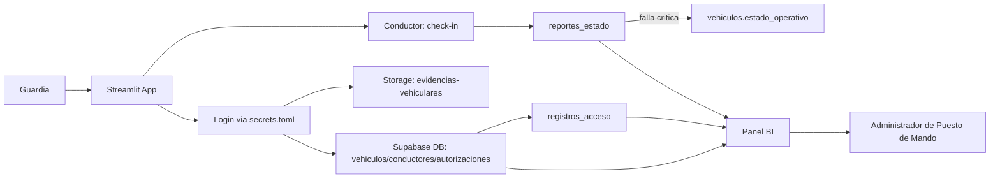

# Informe tecnico

## 1. Objetivo del sistema
El proyecto implementa una solucion para control de acceso vehicular, con validacion automatica basada en patente, conductor, autorizacion vigente y estado operacional del vehiculo.

## 2. Arquitectura de software
Se utiliza una arquitectura modular en capas:
- Capa de presentacion: Streamlit (tres vistas condicionadas por perfil de sesion)
- Capa de negocio: validaciones de acceso, regla de criticidad mecanica y metricas BI
- Capa de persistencia: Supabase (Postgres + Storage)

### Diagrama de flujo de datos


## 3. Decisiones de arquitectura
- Streamlit como frontend rapido y simple para entregas academicas.
- Autenticacion propia y simple: las credenciales de los 3 perfiles (Guardia, Conductor,
  Administrador) se definen en `.streamlit/secrets.toml` (`[usuarios]`) y se validan con
  `hmac.compare_digest`. No se usa Supabase Auth, por lo que no existen sesiones de
  `auth.users` ni RLS basada en `auth.uid()`: las tablas quedan accesibles con la clave
  publica (anon/publishable) de Supabase, que es la unica que debe viajar en el cliente.
- `st.session_state` guarda el perfil autenticado y controla la navegacion condicional
  entre las vistas de Guardia, Conductor y Administrador (`main()` en `app.py`).
- Tablas separadas por dominio: conductores, vehiculos, autorizaciones, reportes_estado
  y registros_acceso (bitacora de Guardia).
- Validaciones de integridad en base de datos (llaves foraneas, CHECK de rangos y de
  valores permitidos en `resolucion`/`estado_operativo`).
- Bucket `evidencias-vehiculares` publico, con limite de 800 KB por imagen aplicado en
  dos capas: `file_size_limit` del bucket y compresion JPEG progresiva en `app.py`
  (`_comprimir_imagen`) antes de subir.

## 4. Modulos implementados
### Guardia de Garita (`vista_guardia`)
- Ingreso de patente y RUT, normalizados con expresiones regulares.
- Consulta cruzada en Supabase (`validar_acceso`): existencia del vehiculo, existencia
  y estado del conductor, y vigencia de la autorizacion para ese par patente/RUT.
- Resolucion mostrada: Autorizado / Denegado / Alerta de Estado (vehiculo no operativo
  pero con autorizacion vigente).
- Registro del resultado y la evidencia fotografica en `registros_acceso`.

### Conductor Operativo (`vista_conductor`)
- Formulario de check-in: kilometraje, nivel de combustible, presion de neumaticos,
  luces y novedades mecanicas criticas, con foto de respaldo.
- `evaluar_criticidad` determina si el reporte fuerza el cambio automatico de
  `vehiculos.estado_operativo` a "Requiere Mantención" (frenos, presion severa de
  neumaticos, direccion, motor, falla de luces o baja presion simple).

### Administrador de Puesto de Mando (`vista_administrador`)
- KPIs: disponibilidad global de la flota, unidades inmovilizadas/criticas, accesos
  del dia y denegados/alerta del dia.
- Matriz de estado por vehiculo con codigo de color (verde/amarillo/rojo) y cambio
  manual de estado.
- Alertas por fallas mecanicas reportadas por conductores.
- Analitica de kilometraje acumulado y frecuencia de accesos por sector/unidad.
- Feed cronologico de accesos y auditoria de incidencias por patente (fotos +
  informes almacenados en Supabase Storage).
- El panel se refresca automaticamente cada 30 segundos (`st.fragment(run_every="30s")`).

## 5. Base de datos
- `conductores`, `vehiculos`, `autorizaciones`, `reportes_estado`: definidas en
  `supabase/01_esquema.sql` (script base de catedra, con datos de prueba).
- `registros_acceso`: definida en `supabase/02_registros_acceso_y_storage.sql`, agregada
  para sostener la bitacora de Guardia y el feed/auditoria del panel BI.
- Bucket `evidencias-vehiculares`: definido en el mismo script, publico y con limite
  de 800 KB.

## 6. Validacion
La aplicacion fue verificada con:
```bash
python -m py_compile app.py
streamlit run app.py
```
Resultado: compilacion exitosa y la app levanta y responde en `http://localhost:8501`.

**Pendiente antes de la demo:** la `SUPABASE_PUBLISHABLE_KEY` configurada actualmente es
rechazada por el proyecto de Supabase ("Invalid API key"). Debe reemplazarse por la clave
anon/publishable real desde *Project Settings > API* antes de poder consultar datos reales.

## 7. Evidencias de funcionamiento
Documentar con capturas una vez reemplazada la clave de Supabase:
- Login de cada perfil (Guardia, Conductor, Administrador).
- Validacion de acceso Autorizado/Denegado/Alerta de Estado con foto.
- Check-in de conductor que dispara "Requiere Mantención".
- Panel BI: KPIs, matriz de estado, feed y auditoria por patente.

## 8. Conclusiones
La plataforma queda preparada para ejecutar en entorno local mediante VS Code, con un
esquema de datos y una capa de aplicacion coherentes entre si, y para despliegue
posterior en Streamlit Cloud + Supabase una vez configurada la clave publica valida.
